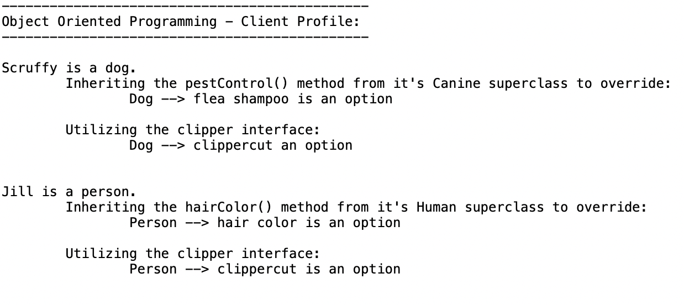

# Java Interface Example

A simple demonstration of Java interfaces, abstraction, inheritance, and method overriding using dogs and people.

## Concepts Demonstrated

- **Abstraction** — defining what an object can do without specifying how
- **Interfaces** — establishing shared behaviors for different classes
- **Inheritance** — reusing and extending superclass functionality
- **Polymorphism** — allowing different objects to share common behaviors
- **Method overriding** — customizing inherited methods

## Output

